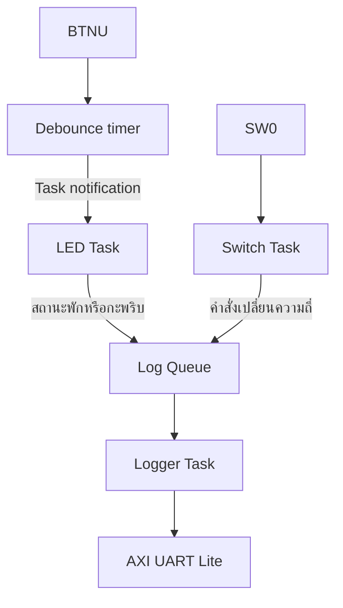

# FreeRTOS LAB 05 — Logger Task และ Queue บน MicroBlaze

ต่อจาก [FreeRTOS LAB 04 — Debounce ปุ่ม BTNU](https://chatgpt.com/library?file_id=libfile_fef67f3e9f0c819192472220b1e44121&account_id=personal) เพิ่ม **Logger Task** ให้รายงานการหยุดหรือกลับมากะพริบ LED0 และการเปลี่ยนความถี่ผ่าน USB UART งานควบคุมส่งรหัสเหตุการณ์เข้าคิว ส่วน Logger Task อ่านคิวและส่งข้อความไปยัง Serial Terminal

**อุปกรณ์** Nexys A7-100T, สาย USB-JTAG ที่ส่งข้อมูลได้, โปรเจกต์ LAB 04 และ Vivado กับ Vitis Unified IDE รุ่นเดียวกัน ใช้ Classic MicroBlaze แบบ FreeRTOS



## 1. เพิ่ม AXI UART Lite ใน Vivado

1. ใช้สำเนา Block Design ของ LAB 04 เพิ่ม **AXI UART Lite** เชื่อม S_AXI เข้ากับ AXI interconnect ของ MicroBlaze ใช้ clock 100 MHz และ peripheral reset ชุดเดิม
2. ตั้ง UART เป็น **115200 baud, 8 data bits, no parity** ปล่อยขา interrupt ของ UART ไว้ แล้วใช้ Make External ที่อินเทอร์เฟซ UART ตรวจชื่อ RX/TX ใน HDL wrapper
3. เพิ่ม constraints ด้านล่างใน XDC เมื่อพอร์ตมีชื่อ `uart_rxd` และ `uart_txd` หากใช้ชื่ออื่นให้แก้ให้ตรง หาก Vivado ผูกขา UART ผ่าน Board Interface แล้ว ให้ใช้การผูกขาเพียงชุดเดียว

```tcl
set_property -dict {PACKAGE_PIN C4 IOSTANDARD LVCMOS33} [get_ports {uart_rxd}]
set_property -dict {PACKAGE_PIN D4 IOSTANDARD LVCMOS33} [get_ports {uart_txd}]
```

4. ตรวจ Address Editor ตัวอย่างใช้ AXI UART Lite ที่ `0x40600000` และ AXI GPIO ที่ `0x40000000` เก็บเส้นทาง AXI Timer → AXI INTC → MicroBlaze ไว้สำหรับ FreeRTOS tick จากนั้น Validate Design, Generate Bitstream และ Export Hardware พร้อม Include bitstream

## 2. สร้างเฟิร์มแวร์ใน Vitis

สร้างและ build Platform Component จาก XSA ของ LAB 05 โดยใช้ FreeRTOS domain ตั้ง Software Timers และ Task Notifications ตาม LAB 04 ใช้ tick rate 1,000 Hz สร้าง Empty Application และเพิ่ม `src/main.c` โค้ดเขียนไปยัง TX FIFO ของ UART โดยตรง

```c
#include <stdint.h>

#include "FreeRTOS.h"
#include "queue.h"
#include "task.h"
#include "timers.h"
#include "xil_io.h"

#define GPIO_BASE           0x40000000U
#define UART_BASE           0x40600000U
#define UART_TX             (UART_BASE + 0x04U)
#define UART_STATUS         (UART_BASE + 0x08U)
#define UART_TX_FULL        (1U << 3)
#define LOG_QUEUE_LENGTH    8U
#define SW_DATA             (GPIO_BASE + 0x00U)
#define LED_DATA            (GPIO_BASE + 0x08U)
#define GPIO_BIT            0x01U
#define BUTTON_BIT          0x02U
#define EVENT_BLINK         (1UL << 0)
#define EVENT_BUTTON        (1UL << 1)
#define BUTTON_SAMPLE_MS    10U
#define BUTTON_SAMPLES      3U

#define SWITCH_SAMPLE_MS    50U
#define SLOW_HALF_PERIOD_MS 500U
#define FAST_HALF_PERIOD_MS 125U
#define STACK_WORDS         256U

enum log_event {
    LOG_PAUSED, LOG_RESUMED, LOG_SLOW, LOG_FAST
};

static QueueHandle_t log_queue;
static TaskHandle_t led_task_handle;
static TimerHandle_t blink_timer;
static TickType_t initial_period;

static TickType_t read_blink_period(void)
{
    return (Xil_In32(SW_DATA) & GPIO_BIT) == 0U ?
           pdMS_TO_TICKS(SLOW_HALF_PERIOD_MS) :
           pdMS_TO_TICKS(FAST_HALF_PERIOD_MS);
}

static void post_log(enum log_event event)
{
    (void)xQueueSend(log_queue, &event, 0U);
}

static void uart_print(const char *message)
{
    while (*message != '\0') {
        while ((Xil_In32(UART_STATUS) & UART_TX_FULL) != 0U) {
            vTaskDelay(1U);
        }
        Xil_Out32(UART_TX, (unsigned char)*message);
        ++message;
    }
}

static void logger_task(void *argument)
{
    (void)argument;
    static const char *const messages[] = {
        "LED PAUSED\r\n", "LED RESUMED\r\n", "RATE 1 Hz\r\n", "RATE 4 Hz\r\n"
    };

    uart_print("FreeRTOS LAB 05 ready\r\n");
    for (;;) {
        enum log_event event;
        if (xQueueReceive(log_queue, &event, portMAX_DELAY) == pdPASS) {
            uart_print(messages[event]);
        }
    }
}

static void blink_callback(TimerHandle_t timer)
{
    (void)timer;
    (void)xTaskNotify(led_task_handle, EVENT_BLINK, eSetBits);
}

static void button_callback(TimerHandle_t timer)
{
    (void)timer;
    static u32 stable;
    static unsigned int different_samples;
    u32 raw = Xil_In32(SW_DATA) & BUTTON_BIT;

    if (raw == stable) {
        different_samples = 0U;
    } else if (++different_samples == BUTTON_SAMPLES) {
        different_samples = 0U;
        stable = raw;
        if (stable != 0U) {
            (void)xTaskNotify(led_task_handle, EVENT_BUTTON, eSetBits);
        }
    }
}

static void led_task(void *argument)
{
    (void)argument;
    u32 led_state = 0U;
    u32 paused = 0U;

    for (;;) {
        uint32_t events;
        if (xTaskNotifyWait(0U, UINT32_MAX, &events, portMAX_DELAY) != pdTRUE) {
            continue;
        }

        if ((events & EVENT_BUTTON) != 0U) {
            paused ^= 1U;
            led_state = 0U;
            Xil_Out32(LED_DATA, led_state);
            post_log(paused != 0U ? LOG_PAUSED : LOG_RESUMED);
        } else if (paused == 0U && (events & EVENT_BLINK) != 0U) {
            led_state ^= GPIO_BIT;
            Xil_Out32(LED_DATA, led_state);
        }
    }
}

static void switch_task(void *argument)
{
    (void)argument;
    TickType_t previous_period = initial_period;

    for (;;) {
        TickType_t period = read_blink_period();
        if (period != previous_period &&
            xTimerChangePeriod(blink_timer, period, 0U) == pdPASS) {
            previous_period = period;
            post_log(period == pdMS_TO_TICKS(SLOW_HALF_PERIOD_MS) ? LOG_SLOW : LOG_FAST);
        }

        vTaskDelay(pdMS_TO_TICKS(SWITCH_SAMPLE_MS));
    }
}

int main(void)
{
    Xil_Out32(LED_DATA, 0U);
    log_queue = xQueueCreate(LOG_QUEUE_LENGTH, sizeof(enum log_event));
    if (log_queue == NULL) {
        return 1;
    }

    initial_period = read_blink_period();
    post_log(initial_period == pdMS_TO_TICKS(SLOW_HALF_PERIOD_MS) ? LOG_SLOW : LOG_FAST);
    blink_timer = xTimerCreate("Blink", initial_period, pdTRUE,
                               NULL, blink_callback);

    TimerHandle_t button_timer = xTimerCreate(
        "Button", pdMS_TO_TICKS(BUTTON_SAMPLE_MS), pdTRUE, NULL, button_callback);

    if (blink_timer == NULL || button_timer == NULL) {
        return 1;
    }

    if (xTaskCreate(led_task, "LED", STACK_WORDS, NULL,
                    tskIDLE_PRIORITY + 1U, &led_task_handle) != pdPASS ||
        xTaskCreate(switch_task, "Switch", STACK_WORDS, NULL,
                    tskIDLE_PRIORITY + 1U, NULL) != pdPASS ||
        xTaskCreate(logger_task, "Logger", STACK_WORDS, NULL,
                    tskIDLE_PRIORITY + 1U, NULL) != pdPASS) {
        return 1;
    }

    if (xTimerStart(blink_timer, 0U) != pdPASS ||
        xTimerStart(button_timer, 0U) != pdPASS) {
        return 1;
    }

    vTaskStartScheduler();
    return 1;
}
```

LED Task ส่งข้อความหลังเปลี่ยนสถานะ ส่วน Switch Task ส่งข้อความเมื่อ FreeRTOS รับคำสั่งเปลี่ยนคาบเข้าคิวของ Timer Service แล้ว คิวสำหรับ Logger เก็บได้ 8 รายการ เมื่อคิวเต็ม `xQueueSend(..., 0U)` จะคืนค่าทันทีและเหตุการณ์ใหม่นั้นจะไม่ถูกเก็บ การส่ง UART เกิดใน Logger Task เท่านั้น

## 3. รันและตรวจผล

ต่อสาย USB เข้าที่พอร์ต USB-JTAG/UART ของบอร์ด เปิด Serial Terminal ที่ **115200 baud, 8-N-1, flow control = None** แล้วรัน LAB 05 จาก Vitis เปิด Terminal ก่อนเริ่มโปรแกรมเพื่อดูข้อความเริ่มต้น

| การทดสอบ | ข้อความและผลที่คาดหวัง |
|---|---|
| เริ่มโปรแกรมขณะ SW0 = 0 | `FreeRTOS LAB 05 ready` ตามด้วย `RATE 1 Hz` และ LED0 กะพริบ |
| สลับ SW0 เป็น 1 | `RATE 4 Hz` และ LED0 เปลี่ยนเป็นประมาณ 4 Hz |
| กด BTNU ค้าง | `LED PAUSED` หนึ่งครั้ง และ LED0 ดับ |
| ปล่อย BTNU แล้วกดอีกครั้ง | `LED RESUMED` หนึ่งครั้ง และ LED0 กลับมากะพริบ |
| ปล่อยให้ LED0 กะพริบโดยไม่เปลี่ยนอินพุต | จังหวะ LED0 ยังเดิน และ Terminal ไม่มีข้อความเพิ่ม |

หาก LED0 ทำงานแต่ Terminal เงียบ ให้ตรวจ base address ของ UART, พอร์ต USB Serial และทิศทาง RX/TX ใน XDC

**แบบฝึกหัด** เพิ่ม `vTaskDelay(pdMS_TO_TICKS(1000U))` หลังการพิมพ์แต่ละเหตุการณ์ใน Logger Task แล้วสลับ SW0 หลายครั้งในเวลาไม่กี่วินาที สังเกตว่าการควบคุม LED ยังตอบสนองอย่างไรขณะที่ข้อความ UART ตามหลัง และทดลองตรวจค่า return ของ `xQueueSend` เมื่อคิวเต็ม

## เอกสารอ้างอิง

- [AMD AXI UART Lite PG142](https://docs.amd.com/api/khub/documents/dB1MAeh~uLG7FE62a5_QbA/content)
- [Digilent Nexys A7-100T Master XDC](https://github.com/Digilent/digilent-xdc/blob/master/Nexys-A7-100T-Master.xdc)
- [FreeRTOS Reference Manual — Queues, Timers, and Tasks](https://www.freertos.org/media/2018/FreeRTOS_Reference_Manual_V10.0.0.pdf)
