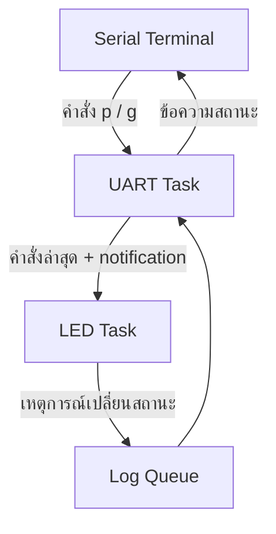

# FreeRTOS LAB 06 — ควบคุม LED จาก Serial Terminal

ต่อจาก [FreeRTOS LAB 05 — Logger Task และ Queue](https://chatgpt.com/library?file_id=libfile_4f9a234ed9948191bed424ff4e09cb7a&account_id=personal) ให้ **UART Task** รับคำสั่งจากคอมพิวเตอร์และรายงานเหตุการณ์กลับทาง Serial Terminal ส่วน **LED Task** รับคำสั่งแล้วอัปเดตสถานะ LED0

| อินพุต | การทำงาน |
|---|---|
| `p` | พักการกะพริบและดับ LED0 |
| `g` | กลับมากะพริบตามความถี่ของ SW0 |
| `?` | แสดงรายการคำสั่ง |
| BTNU | สลับระหว่างพักกับกะพริบ ผ่าน debounce เดิม |
| SW0 | เลือก 1 Hz หรือ 4 Hz |

**อุปกรณ์** Nexys A7-100T, USB-JTAG และ XSA/bitstream ของ FreeRTOS LAB 05 ใช้ Classic MicroBlaze

## 1. เตรียมโปรเจกต์ใน Vitis

ใช้ฮาร์ดแวร์เดิมและสร้าง Empty Application ใหม่บน FreeRTOS domain ของ LAB 05 ตั้ง tick rate ที่ 1,000 Hz พร้อมเปิด Software Timers, Task Notifications และ dynamic allocation ตาม LAB ก่อนหน้า UART ใช้การอ่านแบบ polling ใน UART Task และใช้ AXI Timer เป็นแหล่ง kernel tick ตามเดิม

ตรวจว่า RX และ TX ของ AXI UART Lite ต่อกับ USB UART แล้ว และแก้ base address ของ GPIO หรือ UART ในตัวอย่างเมื่อค่าใน Address Editor ต่างออกไป



## 2. โปรแกรม C

เพิ่มโค้ดเป็น `src/main.c` แล้ว build application สำหรับ LAB 06

```c
#include <stdint.h>

#include "FreeRTOS.h"
#include "queue.h"
#include "task.h"
#include "timers.h"
#include "xil_io.h"

#define GPIO_BASE           0x40000000U
#define UART_BASE           0x40600000U
#define UART_RX             (UART_BASE + 0x00U)
#define UART_TX             (UART_BASE + 0x04U)
#define UART_STATUS         (UART_BASE + 0x08U)
#define UART_RX_VALID       (1U << 0)
#define UART_TX_FULL        (1U << 3)
#define LOG_QUEUE_LENGTH    8U
#define SW_DATA             (GPIO_BASE + 0x00U)
#define LED_DATA            (GPIO_BASE + 0x08U)
#define GPIO_BIT            0x01U
#define BUTTON_BIT          0x02U
#define EVENT_BLINK         (1UL << 0)
#define EVENT_BUTTON        (1UL << 1)
#define EVENT_SERIAL        (1UL << 2)
#define UART_POLL_MS        5U
#define BUTTON_SAMPLE_MS    10U
#define BUTTON_SAMPLES      3U

#define SWITCH_SAMPLE_MS    50U
#define SLOW_HALF_PERIOD_MS 500U
#define FAST_HALF_PERIOD_MS 125U
#define STACK_WORDS         256U

enum log_event {
    LOG_PAUSED, LOG_RESUMED, LOG_SLOW, LOG_FAST
};

static QueueHandle_t log_queue;
static QueueHandle_t command_queue;
static TaskHandle_t led_task_handle;
static TimerHandle_t blink_timer;
static TickType_t initial_period;

static TickType_t read_blink_period(void)
{
    return (Xil_In32(SW_DATA) & GPIO_BIT) == 0U ?
           pdMS_TO_TICKS(SLOW_HALF_PERIOD_MS) :
           pdMS_TO_TICKS(FAST_HALF_PERIOD_MS);
}

static void post_log(enum log_event event)
{
    (void)xQueueSend(log_queue, &event, 0U);
}

static void uart_print(const char *message)
{
    while (*message != '\0') {
        while ((Xil_In32(UART_STATUS) & UART_TX_FULL) != 0U) {
            vTaskDelay(1U);
        }
        Xil_Out32(UART_TX, (unsigned char)*message);
        ++message;
    }
}

static void handle_serial(unsigned char command)
{
    if (command == 'p' || command == 'g') {
        u32 requested_pause = (command == 'p') ? 1U : 0U;
        (void)xQueueOverwrite(command_queue, &requested_pause);
        (void)xTaskNotify(led_task_handle, EVENT_SERIAL, eSetBits);
    } else if (command == '?') {
        uart_print("p: pause | g: go | BTNU: toggle | SW0: rate\r\n");
    } else if (command != '\r' && command != '\n') {
        uart_print("Unknown command. Send ?\r\n");
    }
}

static void uart_task(void *argument)
{
    (void)argument;
    static const char *const messages[] = {
        "LED PAUSED\r\n", "LED RESUMED\r\n", "RATE 1 Hz\r\n", "RATE 4 Hz\r\n"
    };

    uart_print("FreeRTOS LAB 06 ready. Send ? for help.\r\n");
    for (;;) {
        if ((Xil_In32(UART_STATUS) & UART_RX_VALID) != 0U) {
            handle_serial((unsigned char)Xil_In32(UART_RX));
        }

        enum log_event event;
        if (xQueueReceive(log_queue, &event, pdMS_TO_TICKS(UART_POLL_MS)) == pdPASS) {
            uart_print(messages[event]);
        }
    }
}

static void blink_callback(TimerHandle_t timer)
{
    (void)timer;
    (void)xTaskNotify(led_task_handle, EVENT_BLINK, eSetBits);
}

static void button_callback(TimerHandle_t timer)
{
    (void)timer;
    static u32 stable;
    static unsigned int different_samples;
    u32 raw = Xil_In32(SW_DATA) & BUTTON_BIT;

    if (raw == stable) {
        different_samples = 0U;
    } else if (++different_samples == BUTTON_SAMPLES) {
        different_samples = 0U;
        stable = raw;
        if (stable != 0U) {
            (void)xTaskNotify(led_task_handle, EVENT_BUTTON, eSetBits);
        }
    }
}

static void led_task(void *argument)
{
    (void)argument;
    u32 led_state = 0U;
    u32 paused = 0U;

    for (;;) {
        uint32_t events;
        if (xTaskNotifyWait(0U, UINT32_MAX, &events, portMAX_DELAY) != pdTRUE) {
            continue;
        }

        u32 requested_pause = paused;
        if ((events & EVENT_BUTTON) != 0U) {
            requested_pause ^= 1U;
        }
        if ((events & EVENT_SERIAL) != 0U) {
            (void)xQueueReceive(command_queue, &requested_pause, 0U);
        }

        if (requested_pause != paused) {
            paused = requested_pause;
            led_state = 0U;
            Xil_Out32(LED_DATA, led_state);
            post_log(paused != 0U ? LOG_PAUSED : LOG_RESUMED);
        } else if (paused == 0U && (events & EVENT_BLINK) != 0U) {
            led_state ^= GPIO_BIT;
            Xil_Out32(LED_DATA, led_state);
        }
    }
}

static void switch_task(void *argument)
{
    (void)argument;
    TickType_t previous_period = initial_period;

    for (;;) {
        TickType_t period = read_blink_period();
        if (period != previous_period &&
            xTimerChangePeriod(blink_timer, period, 0U) == pdPASS) {
            previous_period = period;
            post_log(period == pdMS_TO_TICKS(SLOW_HALF_PERIOD_MS) ? LOG_SLOW : LOG_FAST);
        }

        vTaskDelay(pdMS_TO_TICKS(SWITCH_SAMPLE_MS));
    }
}

int main(void)
{
    Xil_Out32(LED_DATA, 0U);
    log_queue = xQueueCreate(LOG_QUEUE_LENGTH, sizeof(enum log_event));
    command_queue = xQueueCreate(1U, sizeof(u32));
    if (log_queue == NULL || command_queue == NULL) {
        return 1;
    }

    initial_period = read_blink_period();
    post_log(initial_period == pdMS_TO_TICKS(SLOW_HALF_PERIOD_MS) ? LOG_SLOW : LOG_FAST);
    blink_timer = xTimerCreate("Blink", initial_period, pdTRUE,
                               NULL, blink_callback);

    TimerHandle_t button_timer = xTimerCreate(
        "Button", pdMS_TO_TICKS(BUTTON_SAMPLE_MS), pdTRUE, NULL, button_callback);

    if (blink_timer == NULL || button_timer == NULL) {
        return 1;
    }

    if (xTaskCreate(led_task, "LED", STACK_WORDS, NULL,
                    tskIDLE_PRIORITY + 1U, &led_task_handle) != pdPASS ||
        xTaskCreate(switch_task, "Switch", STACK_WORDS, NULL,
                    tskIDLE_PRIORITY + 1U, NULL) != pdPASS ||
        xTaskCreate(uart_task, "UART", STACK_WORDS, NULL,
                    tskIDLE_PRIORITY + 1U, NULL) != pdPASS) {
        return 1;
    }

    if (xTimerStart(blink_timer, 0U) != pdPASS ||
        xTimerStart(button_timer, 0U) != pdPASS) {
        return 1;
    }

    vTaskStartScheduler();
    return 1;
}
```

UART Task เขียนคำสั่งลงคิวหนึ่งช่องด้วย `xQueueOverwrite` แล้วส่ง notification ให้ LED Task ตื่นมาอ่านค่า หากมีหลายคำสั่งค้างพร้อมกันจะใช้ค่าล่าสุด ในรอบที่ได้รับทั้งคำสั่ง UART และเหตุการณ์ BTNU พร้อมกัน LED Task ให้คำสั่ง UART ที่อ่านได้เป็นตัวกำหนดสถานะสุดท้าย การส่ง `p` ซ้ำขณะพักจะคงสถานะพัก และมีข้อความรายงานเมื่อสถานะเปลี่ยน

UART Task รอคิวข้อความครั้งละไม่เกิน 5 ms ก่อนกลับไปอ่าน UART อีกครั้งเมื่อไม่มีข้อความให้ส่ง ใช้คำสั่งทีละตัวในการทดลองเพื่อให้สังเกตผลของแต่ละคำสั่งได้

## 3. ทดสอบบนบอร์ด

เปิด Serial Terminal ที่ **115200 baud, 8-N-1, flow control = None** โหลด bitstream ของ LAB 05 แล้วรัน LAB 06 ผ่าน JTAG

| การทดสอบ | ผลที่คาดหวัง |
|---|---|
| ส่ง `?` | เห็นรายการคำสั่ง |
| ส่ง `p` ขณะ LED0 กะพริบ | LED0 ดับและได้ `LED PAUSED` |
| ส่ง `p` ซ้ำ | LED0 ยังดับ |
| ส่ง `g` ขณะพัก | ได้ `LED RESUMED` และ LED0 กลับมากะพริบ |
| ส่ง `p` แล้วกด BTNU หนึ่งครั้ง | LED0 กลับมากะพริบผ่านปุ่ม |
| เปลี่ยน SW0 ระหว่างพัก แล้วส่ง `g` | LED0 กลับมากะพริบที่ความถี่ใหม่ |

หากเห็นข้อความเริ่มต้นแต่พิมพ์คำสั่งแล้วไม่เกิดผล ให้ตรวจว่า RX ของ FPGA ต่อขา C4 ตาม XDC ของ LAB 05 และ Terminal ใช้พอร์ตเดียวกับที่รับข้อความ

**แบบฝึกหัด** เพิ่มคำสั่ง `t` สำหรับสลับสถานะจาก Terminal ให้ UART Task ส่งเหตุการณ์สลับแบบเดียวกับ BTNU แล้วทดลองสั่ง `p`, `t`, `t` ทีละตัว ควรได้สถานะพัก → กะพริบ → พัก

## เอกสารอ้างอิง

- [AMD AXI UART Lite PG142](https://docs.amd.com/api/khub/documents/dB1MAeh~uLG7FE62a5_QbA/content)
- [FreeRTOS Reference Manual — Queues and Task Notifications](https://www.freertos.org/media/2018/FreeRTOS_Reference_Manual_V10.0.0.pdf)
