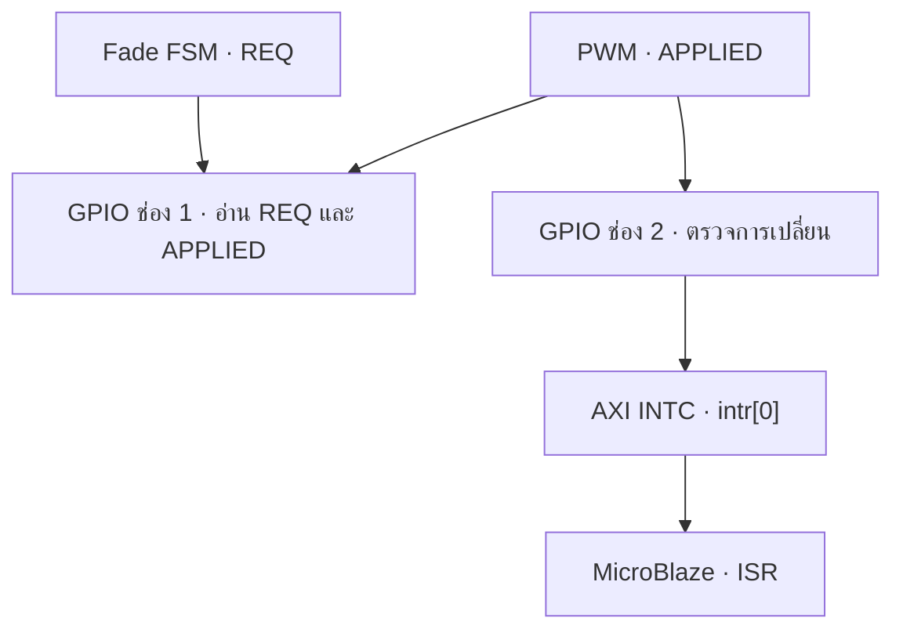

# LAB 10 — รายงานการเปลี่ยน PWM ด้วย AXI GPIO Interrupt

ต่อจาก [LAB 09 — อ่านสถานะ PWM ผ่าน AXI GPIO](https://chatgpt.com/library?file_id=libfile_26c14d74b720819197e2112ba129b214&account_id=personal) ให้ MicroBlaze ส่งข้อความ `EVENT` อัตโนมัติเมื่อ **APPLIED** เปลี่ยน คำสั่ง `r` ยังอ่านสถานะได้ตามต้องการ นักศึกษาจะได้ฝึกตั้ง interrupt เฉพาะช่องอินพุตที่ต้องการและส่งงานจาก ISR ไปให้โปรแกรมหลัก

**อุปกรณ์** Nexys A7-100T, USB-JTAG, โปรเจกต์ LAB 09, Vivado และ Vitis Unified IDE รุ่นเดียวกัน ใช้ Classic MicroBlaze แบบ Standalone

## 1. ตั้ง AXI GPIO และ AXI INTC ใน Vivado

1. เปิดสำเนาโปรเจกต์ LAB 09 ตั้ง `axi_gpio_status` เป็น **Dual Channel** และเลือก **Enable Interrupt** ช่อง 1 เป็น **All Inputs, Width = 6** ช่อง 2 เป็น **All Inputs, Width = 3**
2. เก็บการต่อ Concat เดิมไว้ที่ `gpio_io_i[5:0]` ของช่อง 1 ให้บิต `[5:3]` เป็น REQ และบิต `[2:0]` เป็น APPLIED จากนั้นแตกสาย `led_pwm/applied_level[2:0]` ไปยัง `gpio2_io_i[2:0]` ของช่อง 2 ด้วย
3. ใช้ AXI INTC เดิมจาก LAB 07 หากมีอยู่ หรือเพิ่ม **AXI Interrupt Controller** แล้วเชื่อม `S_AXI` กับ AXI interconnect ใช้ clock 100 MHz และ peripheral reset ชุดเดียวกับ GPIO
4. ถอดเส้น AXI Timer ออกจาก `intr[0]` และต่อ `axi_gpio_status/ip2intc_irpt` เข้าช่องนี้แทน ตั้ง AXI INTC ให้รับแหล่งเดียวแบบ **active-high level** แล้วต่อเอาต์พุต interrupt ของ INTC กับ `MicroBlaze/INTERRUPT` ใน normal interrupt mode หากมี Concat ในเส้น IRQ ให้ต่อ GPIO ที่ `In0`
5. ตรวจ Address Editor ให้ GPIO สถานะและ INTC ตรงกับค่าในโค้ด ตัวอย่างใช้ `0x40010000` และ `0x41200000` ตามลำดับ ใช้ XDC และ RTL เดิมจาก LAB 09 จากนั้น Validate Design, Generate Bitstream และ Export Hardware พร้อม Include bitstream



โปรแกรมเปิด interrupt เฉพาะช่อง 2 การเปลี่ยน REQ จึงยังอ่านได้จากช่อง 1 ส่วนข้อความ `EVENT` จะเกิดเมื่อ PWM นำค่าไปใช้และ APPLIED เปลี่ยนจริง ระดับเดิมที่ถูกเขียนซ้ำจะไม่ทำให้เกิดการเปลี่ยนที่อินพุตช่อง 2

## 2. เขียนโปรแกรมใน Vitis

สร้าง platform จาก XSA ของ LAB 10 และสร้าง Empty Application บนโดเมน Standalone ใส่โค้ดด้านล่างใน `src/main.c` ตรวจ base address ของ UART, GPIO คำสั่ง, GPIO สถานะ และ INTC ให้ตรงกับ Address Editor

```c
#include "mb_interface.h"
#include "xil_io.h"

#define GPIO_BASE         0x40000000U
#define STATUS_GPIO_BASE  0x40010000U
#define UART_BASE         0x40600000U

#define SW_DATA           (GPIO_BASE + 0x00U)
#define PWM_SELECT        (GPIO_BASE + 0x08U)
#define PWM_STATUS        (STATUS_GPIO_BASE + 0x00U)
#define LEVEL_MASK        0x07U
#define REQUESTED_SHIFT   3U
#define SW0_MASK          0x01U

#define UART_RX           (UART_BASE + 0x00U)
#define UART_TX           (UART_BASE + 0x04U)
#define UART_STATUS       (UART_BASE + 0x08U)
#define UART_CONTROL      (UART_BASE + 0x0CU)
#define UART_RX_VALID     (1U << 0)
#define UART_TX_FULL      (1U << 3)
#define UART_RESET_FIFOS  0x03U

#define STATUS_GIER        (STATUS_GPIO_BASE + 0x11CU)
#define STATUS_IPISR       (STATUS_GPIO_BASE + 0x120U)
#define STATUS_IPIER       (STATUS_GPIO_BASE + 0x128U)
#define STATUS_CH2_IRQ     (1U << 1)
#define STATUS_GLOBAL_IRQ  (1U << 31)

#define INTC_BASE          0x41200000U
#define INTC_IER           (INTC_BASE + 0x08U)
#define INTC_IAR           (INTC_BASE + 0x0CU)
#define INTC_MER           (INTC_BASE + 0x1CU)
#define INTC_GPIO_IRQ      (1U << 0)
#define INTC_ENABLE        0x03U

#define FADE_ENABLE  (1U << 3)
#define FADE_RESTART (1U << 4)

enum control_mode { MODE_SWITCH, MODE_MANUAL, MODE_FADE };

static enum control_mode mode = MODE_SWITCH;
static u32 manual_level;
static u32 restart_token;
static volatile u32 applied_events;

static void gpio_isr(void *callback_ref)
{
    (void)callback_ref;
    if ((Xil_In32(STATUS_IPISR) & STATUS_CH2_IRQ) != 0U) {
        Xil_Out32(STATUS_IPISR, STATUS_CH2_IRQ);
        ++applied_events;
    }
    Xil_Out32(INTC_IAR, INTC_GPIO_IRQ);
}

static void init_gpio_interrupt(void)
{
    microblaze_disable_interrupts();
    Xil_Out32(INTC_MER, 0U);
    Xil_Out32(INTC_IER, 0U);
    Xil_Out32(STATUS_GIER, 0U);
    Xil_Out32(STATUS_IPIER, 0U);

    u32 pending = Xil_In32(STATUS_IPISR) & STATUS_CH2_IRQ;
    Xil_Out32(STATUS_IPISR, pending);
    Xil_Out32(INTC_IAR, INTC_GPIO_IRQ);
    microblaze_register_handler(gpio_isr, 0);

    Xil_Out32(STATUS_IPIER, STATUS_CH2_IRQ);
    Xil_Out32(STATUS_GIER, STATUS_GLOBAL_IRQ);
    Xil_Out32(INTC_IER, INTC_GPIO_IRQ);
    Xil_Out32(INTC_MER, INTC_ENABLE);
    microblaze_enable_interrupts();
}

static u32 selected_control(void)
{
    if (mode == MODE_FADE) {
        return FADE_ENABLE | restart_token;
    }

    u32 level = manual_level;
    if (mode == MODE_SWITCH) {
        level = (Xil_In32(SW_DATA) & SW0_MASK) == 0U ? 1U : 3U;
    }
    return restart_token | level;
}

static void uart_print(const char *message)
{
    while (*message != '\0') {
        while ((Xil_In32(UART_STATUS) & UART_TX_FULL) != 0U) {
        }
        Xil_Out32(UART_TX, (unsigned char)*message);
        ++message;
    }
}

static void report_pwm(const char *prefix)
{
    static const char *const values[] = {"0%", "25%", "50%", "75%", "100%"};

    u32 status = Xil_In32(PWM_STATUS);
    u32 applied = status & LEVEL_MASK;
    u32 requested = (status >> REQUESTED_SHIFT) & LEVEL_MASK;

    uart_print(prefix);
    uart_print("REQ=");
    uart_print(requested <= 4U ? values[requested] : "invalid");
    uart_print(" APPLIED=");
    uart_print(applied <= 4U ? values[applied] : "invalid");
    uart_print("\r\n");
}

static void handle_command(unsigned char command)
{
    static const char *const replies[] = {
        "OK 0%\r\n", "OK 25%\r\n", "OK 50%\r\n",
        "OK 75%\r\n", "OK 100%\r\n"
    };

    if (command >= '0' && command <= '4') {
        manual_level = (u32)(command - '0');
        mode = MODE_MANUAL;
        uart_print(replies[manual_level]);
    } else if (command == 's' || command == 'S') {
        mode = MODE_SWITCH;
        uart_print("OK SW0 mode\r\n");
    } else if (command == 'f' || command == 'F') {
        restart_token ^= FADE_RESTART;
        mode = MODE_FADE;
        uart_print("OK fade\r\n");
    } else if (command == 'r' || command == 'R') {
        report_pwm("");
    } else if (command == '?') {
        uart_print("0: 0% | 1: 25% | 2: 50% | 3: 75% | 4: 100% | s: SW0 | f: fade | r: read PWM\r\n");
    } else if (command != '\r' && command != '\n') {
        uart_print("Unknown command. Send ?\r\n");
    }
}

int main(void)
{
    Xil_Out32(UART_CONTROL, UART_RESET_FIFOS);

    u32 reported_events = 0U;
    init_gpio_interrupt();

    u32 applied_control = selected_control();
    Xil_Out32(PWM_SELECT, applied_control);
    uart_print("LAB 10 ready. Send ? for help.\r\n");

    for (;;) {
        if ((Xil_In32(UART_STATUS) & UART_RX_VALID) != 0U) {
            handle_command((unsigned char)Xil_In32(UART_RX));
        }

        u32 control = selected_control();
        if (control != applied_control) {
            Xil_Out32(PWM_SELECT, control);
            applied_control = control;
        }

        u32 events = applied_events;
        if (events != reported_events) {
            reported_events = events;
            report_pwm("EVENT ");
        }
    }
}
```

GPIO ใช้ `IPISR` แบบ **toggle-on-write** จึงอ่านบิตค้างก่อนเขียน 1 เพื่อล้าง แล้วจึง acknowledge ที่ INTC ตัว ISR เพิ่มตัวนับเหตุการณ์ ส่วน `main()` อ่านและส่งข้อความผ่าน UART หากหลายเหตุการณ์เกิดก่อนที่โปรแกรมหลักจะส่งข้อความ โปรแกรมจะรายงานสถานะล่าสุดหนึ่งบรรทัด วิธีนี้เหมาะกับการแสดงสถานะสดใน LAB

## 3. รันและทดสอบ

ตั้ง Serial Terminal เป็น **115200 baud, 8-N-1, flow control = None** โหลด bitstream และรันผ่าน USB-JTAG ตอนเริ่มระบบอาจมี `EVENT` หนึ่งบรรทัดเมื่อ PWM รับระดับ SW0 ครั้งแรก

| การทดสอบ | ผลที่คาดหวัง |
|---|---|
| ส่ง `0` รอให้ LED ดับ แล้วส่ง `2` | ได้ `OK 50%` ตามด้วย `EVENT REQ=50% APPLIED=50%` |
| ส่ง `2` ซ้ำขณะอยู่ที่ 50% | ได้ `OK 50%` โดยตัวนับเหตุการณ์คงค่าเดิม |
| ส่ง `f` | ได้ข้อความ `EVENT` ตามขั้นความสว่างทุกประมาณ 250 ms |
| ส่ง `r` ขณะอยู่ในโหมดคงที่ | ได้ค่า REQ และ APPLIED หนึ่งบรรทัด |
| ส่ง `s` แล้วสลับ SW0 | ได้ `EVENT` เมื่อ APPLIED เปลี่ยนระหว่าง 25% และ 75% |

หาก `r` อ่านค่าได้แต่ไม่มี `EVENT` ให้ตรวจว่าเปิด Enable Interrupt ใน GPIO แล้ว และว่าขา APPLIED ต่อเข้าช่อง 2 และเส้น IRQ ต่อไปยัง INTC input 0 หาก ISR เข้าซ้ำต่อเนื่อง ให้ตรวจว่าเขียนล้างบิตช่อง 2 ใน IPISR ก่อน acknowledge ที่ INTC

**แบบฝึกหัด** เพิ่มคำสั่งให้เปิดหรือปิดการพิมพ์ `EVENT` ในโปรแกรมหลัก แล้วตรวจว่าคำสั่ง `r` ยังอ่านสถานะได้และตัวนับใน ISR ยังเพิ่มเมื่อ APPLIED เปลี่ยน

## เอกสารอ้างอิง

- [AMD AXI GPIO PG144 — Interrupts](https://docs.amd.com/r/en-US/pg144-axi-gpio/Interrupts)
- [AMD AXI GPIO PG144 — IP Interrupt Enable and Status Registers](https://docs.amd.com/r/en-US/pg144-axi-gpio/IP-Interrupt-Enable-IPIER-and-IP-Status-Registers-IPISR)
- [AMD AXI INTC PG099](https://docs.amd.com/api/khub/documents/dxFxD3WjWxF7Xen1NcGKcw/content)
