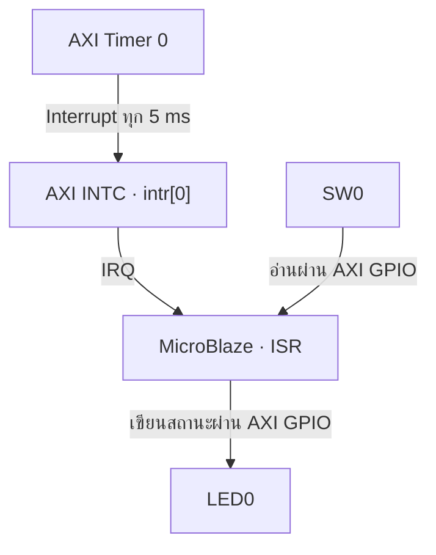

# LAB 03 — AXI Timer Interrupt บน Nexys A7

ต่อจาก [LAB 02 — AXI Timer แบบ polling](https://chatgpt.com/library?file_id=libfile_e7c6e01f9ca08191bb32c3fc4f461ee2&account_id=personal) โดยให้ Timer ส่ง interrupt ทุกประมาณ 5 ms ผ่าน **AXI Interrupt Controller (AXI INTC)** ไปยัง MicroBlaze โปรแกรมย่อยที่ตอบสนองต่อ interrupt หรือ **ISR** จะนับจำนวนครั้งแล้วสลับ LED0 ส่วน `main()` มีเวลาทำงานอื่นระหว่างรอเหตุการณ์

**อุปกรณ์** Nexys A7-100T, USB-JTAG, โปรเจกต์ LAB 02, Vivado และ Vitis Unified IDE รุ่นเดียวกัน ใช้ Classic MicroBlaze และโดเมน Standalone

| SW0 | จำนวน interrupt ต่อการสลับ LED0 | เวลาระหว่างการสลับ | คาบเต็ม | ความถี่ LED0 |
|---|---:|---:|---:|---:|
| 0 | 100 | ≈ 500 ms | ≈ 1 s | ≈ 1 Hz |
| 1 | 25 | ≈ 125 ms | ≈ 250 ms | ≈ 4 Hz |

## 1. เพิ่มเส้นทาง interrupt ใน Vivado



1. เปิดสำเนาโปรเจกต์ LAB 02 ใน **IP Integrator** ใช้ AXI GPIO สองช่องเดิม (ช่อง 1 = SW0, ช่อง 2 = LED0), AXI Timer ขนาด 32 บิต และ clock 100 MHz
2. เพิ่ม **AXI Interrupt Controller** หนึ่งบล็อก หรือใช้บล็อกที่ Block Automation สร้างไว้ เชื่อม `S_AXI` เข้ากับ AXI interconnect ของ MicroBlaze ด้วย **Run Connection Automation** ตรวจ clock และ active-low reset ของ AXI INTC ให้ตรงกับ peripheral เดิม
3. ต่อ `axi_timer_0/interrupt` เข้ากับ `axi_intc_0/intr[0]` ให้ Timer เป็นแหล่ง interrupt เดียว หาก Vivado ใช้ **Concat** ให้ตั้งหนึ่ง input แล้วต่อ Timer เข้าที่ `In0` จากนั้นต่อเอาต์พุตไปยัง `intr`
4. ต่ออินเทอร์เฟซ `axi_intc_0/interrupt` ไปที่ `microblaze_0/INTERRUPT` ใช้ **normal interrupt mode** และตรวจว่า input 0 ของ AXI INTC เป็น **active-high level** (bit 0 ของ `C_KIND_OF_INTR` = 0 และ bit 0 ของ `C_KIND_OF_LVL` = 1) Vivado อาจกำหนดชนิด input ให้อัตโนมัติจาก IP ต้นทาง ตรวจให้ IRQ ไปยัง MicroBlaze เป็นแบบ active-high level ด้วย
5. ตรวจ base address ทั้งสามตัวใน **Address Editor** ของ MicroBlaze หากค่าที่ Vivado กำหนดต่างจากตาราง ให้แก้ค่าคงที่ใน `main.c` ให้ตรงกับโปรเจกต์

| IP | Base address ตัวอย่าง |
|---|---:|
| AXI GPIO | `0x40000000` |
| AXI Timer | `0x41C00000` |
| AXI INTC | `0x41200000` |

6. ใช้ XDC ของ LAB 02 แล้วเลือก **Validate Design → Generate Bitstream → Export Hardware** โดยเลือก **Include bitstream** เพื่อสร้าง XSA ของ LAB 03

## 2. สร้างโปรแกรมใน Vitis Unified IDE

สร้าง **Platform Component** จาก XSA ของ LAB 03 เลือก MicroBlaze และ Standalone แล้ว build platform สร้าง **Empty Application** บน platform นี้ แล้วใส่โค้ดด้านล่างใน `src/main.c`

AXI Timer นับถอยหลังและโหลดค่าใหม่อัตโนมัติ เมื่อ clock เป็น 100 MHz ค่าโหลด 500,000 ให้ช่วงเวลาประมาณ 5 ms ใน ISR ให้ล้างสถานะที่ Timer ก่อน acknowledge ที่ AXI INTC เพื่อให้สัญญาณ level จาก Timer ถูกปลดก่อน อ่าน SW0 เมื่อเริ่มช่วงติดหรือดับใหม่ เพื่อให้การเปลี่ยนโหมดมีผลในครึ่งคาบถัดไป

```c
#include "mb_interface.h"
#include "xil_io.h"

#define GPIO_BASE          0x40000000U
#define TIMER_BASE         0x41C00000U
#define INTC_BASE          0x41200000U

#define SW_DATA            (GPIO_BASE + 0x00U)
#define LED_DATA           (GPIO_BASE + 0x08U)
#define GPIO_BIT           0x01U

#define TIMER_TCSR0        (TIMER_BASE + 0x00U)
#define TIMER_TLR0         (TIMER_BASE + 0x04U)
#define TIMER_EXPIRED      (1U << 8)
#define TIMER_ENABLE       (1U << 7)
#define TIMER_IRQ_ENABLE   (1U << 6)
#define TIMER_LOAD         (1U << 5)
#define TIMER_AUTO_RELOAD  (1U << 4)
#define TIMER_DOWN_COUNT   (1U << 1)
#define TIMER_RUNNING      (TIMER_ENABLE | TIMER_IRQ_ENABLE | \
                            TIMER_AUTO_RELOAD | TIMER_DOWN_COUNT)

#define INTC_IER           (INTC_BASE + 0x08U)
#define INTC_IAR           (INTC_BASE + 0x0CU)
#define INTC_MER           (INTC_BASE + 0x1CU)
#define INTC_TIMER_IRQ     (1U << 0)
#define INTC_MASTER_ENABLE (1U << 0)
#define INTC_HW_ENABLE     (1U << 1)

#define TIMER_LOAD_5_MS    500000U
#define SLOW_IRQS          100U
#define FAST_IRQS          25U

static u32 led_state;
static u32 irqs_remaining;
static volatile u32 foreground_count;

static u32 read_half_period(void)
{
    return (Xil_In32(SW_DATA) & GPIO_BIT) == 0U ? SLOW_IRQS : FAST_IRQS;
}

static void timer_isr(void *callback_ref)
{
    (void)callback_ref;

    if ((Xil_In32(TIMER_TCSR0) & TIMER_EXPIRED) != 0U) {
        /* Clear the peripheral flag while keeping the timer running. */
        Xil_Out32(TIMER_TCSR0, TIMER_RUNNING | TIMER_EXPIRED);

        if (--irqs_remaining == 0U) {
            led_state ^= GPIO_BIT;
            Xil_Out32(LED_DATA, led_state);
            irqs_remaining = read_half_period();
        }
    }

    Xil_Out32(INTC_IAR, INTC_TIMER_IRQ);
}

int main(void)
{
    microblaze_disable_interrupts();

    Xil_Out32(INTC_MER, 0U);
    Xil_Out32(INTC_IER, 0U);
    Xil_Out32(TIMER_TCSR0, TIMER_EXPIRED);
    Xil_Out32(TIMER_TLR0, TIMER_LOAD_5_MS);
    Xil_Out32(TIMER_TCSR0, TIMER_DOWN_COUNT | TIMER_LOAD);

    led_state = 0U;
    Xil_Out32(LED_DATA, led_state);
    irqs_remaining = read_half_period();

    microblaze_register_handler(timer_isr, 0);
    Xil_Out32(INTC_IAR, INTC_TIMER_IRQ);
    Xil_Out32(INTC_IER, INTC_TIMER_IRQ);
    Xil_Out32(INTC_MER, INTC_MASTER_ENABLE | INTC_HW_ENABLE);

    Xil_Out32(TIMER_TCSR0, TIMER_RUNNING);
    microblaze_enable_interrupts();

    for (;;) {
        /* Replace this with a foreground task. */
        ++foreground_count;
    }
}
```

`T0INT` เป็นบิตแบบ **write-one-to-clear** คำสั่งใน ISR จึงเขียน 1 ไปที่บิตสถานะพร้อมคงบิต enable และ auto-reload ไว้ ส่วน `foreground_count` เป็นตัวแปรสาธิตสำหรับดูใน debugger ว่า `main()` ยังทำงานต่อระหว่าง interrupt

## 3. ทดสอบบนบอร์ด

1. Build application แล้วเลือก **Run** แบบ hardware ผ่าน USB-JTAG หากใช้ Debug และหยุดที่ `main()` ให้กด **Resume**
2. ตั้ง SW0 = 0 แล้ววัดเวลาห้าคาบจากขอบขาขึ้นครั้งแรกถึงครั้งที่หก ควรได้ประมาณ **5 s** ทำซ้ำเมื่อ SW0 = 1 ควรได้ประมาณ **1.25 s** รอให้ความถี่ใหม่คงที่ก่อนเริ่มวัด
3. หากต้องการตรวจเส้นทาง interrupt ให้ตั้ง breakpoint ที่ `timer_isr()` แล้วกด Resume เพื่อดูว่าเข้าถึง ISR หรือไม่ จากนั้นเอา breakpoint ออกก่อนวัดคาบ
4. ถ้า LED0 ค้าง ให้ตรวจ XSA, base address, clock/reset และเส้น Timer → INTC → MicroBlaze ถ้า ISR ถูกเรียกซ้ำทันทีและ LED0 กะพริบเร็วผิดปกติ ให้ตรวจว่าล้าง `T0INT` ก่อนเขียน `INTC_IAR` และตั้ง input 0 ของ INTC ตรงกับขั้วสัญญาณจริง

**แบบฝึกหัด** ปรับเฉพาะโหมด SW0 = 1 เป็น 2 Hz โดยคงช่วง interrupt ที่ 5 ms แล้วอธิบายว่าเหตุใดจึงใช้ **50 interrupt ต่อการสลับ LED หนึ่งครั้ง** เปรียบเทียบกับ LAB 02 ว่า `main()` ใช้เวลาระหว่างการสลับ LED ต่างกันอย่างไร

## เอกสารอ้างอิง

- [AMD AXI Timer PG079 — Generate Mode](https://docs.amd.com/r/en-US/pg079-axi-timer/Generate-Mode)
- [AMD AXI Timer PG079 — Interrupts](https://docs.amd.com/r/en-US/pg079-axi-timer/Interrupts)
- [AMD AXI Interrupt Controller PG099](https://docs.amd.com/api/khub/documents/dxFxD3WjWxF7Xen1NcGKcw/content)
- [AMD Standalone BSP UG643 — microblaze_register_handler](https://docs.amd.com/r/en-US/oslib_rm/microblaze_register_handler)
