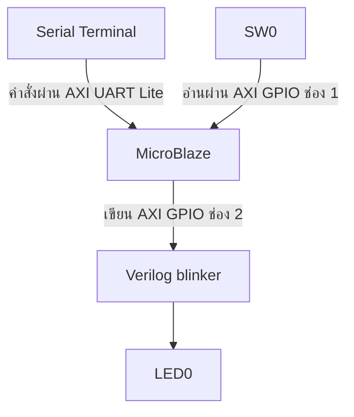

# LAB 05 — MicroBlaze ควบคุมวงจร Verilog ผ่าน AXI GPIO

ต่อจาก [LAB 04 — AXI UART Lite](https://chatgpt.com/library?file_id=libfile_1c4ec58a02f48191bd02fc3d6a72336e&account_id=personal) ใช้ Nexys A7-100T และคำสั่ง Serial ชุดเดิม ใน LAB นี้ MicroBlaze เขียนบิตเลือกความถี่ผ่าน AXI GPIO แล้ววงจร Verilog นับ clock และสลับ LED0 เอง นักศึกษาจะได้ฝึกต่อวงจร RTL เข้ากับ Block Design และกำหนดหน้าที่ของซอฟต์แวร์กับฮาร์ดแวร์

| คำสั่ง UART | ผลที่คาดหวัง |
|---|---|
| 1 | LED0 กะพริบประมาณ 1 Hz |
| 4 | LED0 กะพริบประมาณ 4 Hz |
| s หรือ S | เลือกความถี่ด้วย SW0 โดย 0 = 1 Hz และ 1 = 4 Hz |
| ? | แสดงรายการคำสั่ง |

ส่วนที่ส่งต่อระหว่างซอฟต์แวร์กับ RTL คือบิต fast_select โดย 0 หมายถึงครึ่งคาบ 50,000,000 clocks และ 1 หมายถึงครึ่งคาบ 12,500,000 clocks เมื่อใช้ clock 100 MHz วงจรจะรับบิตเลือกความถี่เมื่อเริ่มครึ่งคาบใหม่เพื่อให้ช่วงที่กำลังทำงานอยู่จบตามเวลาที่ตั้งไว้



## 1. เพิ่มวงจร Verilog

เปิดสำเนาโปรเจกต์ LAB 04 จากนั้นใช้ **Add Sources → Add or Create Design Sources** เพื่อเพิ่ม hw_blinker.v

```verilog
module hw_blinker #(
    parameter [31:0] SLOW_CYCLES = 32'd50_000_000,
    parameter [31:0] FAST_CYCLES = 32'd12_500_000
)(
    input  wire clk,
    input  wire resetn,
    input  wire fast_select,
    output reg  led
);
    reg [31:0] remaining;

    always @(posedge clk) begin
        if (!resetn) begin
            led <= 1'b0;
            remaining <= SLOW_CYCLES - 32'd1;
        end else if (remaining == 32'd0) begin
            led <= ~led;
            remaining <= fast_select ? FAST_CYCLES - 32'd1
                                     : SLOW_CYCLES - 32'd1;
        end else begin
            remaining <= remaining - 32'd1;
        end
    end
endmodule
```

ตัวนับโหลด N − 1 และสลับ LED เมื่ออ่านค่าศูนย์ที่ขอบ clock จึงใช้ N clocks ต่อการสลับหนึ่งครั้ง และ 2N clocks ต่อคาบเต็ม เช่น N = 50,000,000 ให้คาบเต็ม 1 s ที่ clock 100 MHz วงจรเริ่มจาก LED ดับและใช้ครึ่งคาบแรก 500 ms หลังปล่อย reset

## 2. เชื่อม RTL ใน Vivado

1. เปิด Block Design คลิกขวาบนพื้นที่ว่างแล้วเลือก **Add Module → hw_blinker**
2. ลบ external port led0 เดิมที่ต่อกับ AXI GPIO ช่อง 2 จาก Block Design โดยเก็บ AXI GPIO ไว้ ตรวจว่า Channel 1 เป็นอินพุต SW0 ขนาด 1 บิต และ Channel 2 เป็น **All Outputs** ขนาด 1 บิต ค่าเริ่มต้น 0
3. ต่อสัญญาณตามตาราง เปิดกลุ่มอินเทอร์เฟซ GPIO2 เพื่อเลือกขา gpio2_io_o หาก Vivado แสดงเป็นกลุ่มพอร์ต

| ต้นทาง | ปลายทาง |
|---|---|
| สัญญาณ clock 100 MHz ที่จ่ายให้ AXI GPIO s_axi_aclk | hw_blinker/clk |
| Processor System Reset → peripheral_aresetn | hw_blinker/resetn |
| AXI GPIO ช่อง 2 → gpio2_io_o[0] | hw_blinker/fast_select |
| hw_blinker/led | external port led0 |

4. ใช้ **Make External** ที่ขา led แล้วตั้งชื่อเป็น led0 พอร์ตใหม่นี้เป็น scalar ให้ปรับบรรทัด LED0 ใน XDC ของ LAB 04 จาก led0[0] เป็น led0 และตรวจให้ตรงกับ wrapper จริง

```tcl
set_property -dict {PACKAGE_PIN H17 IOSTANDARD LVCMOS33} [get_ports {led0}]
```

5. เก็บการต่อ UART, SW0, clock และ reset ของ LAB 04 ไว้ ใช้โปรแกรม C ของ LAB 05 ที่ไม่เปิด Timer interrupt สามารถเก็บ AXI Timer กับ AXI INTC ใน Block Design เดิมได้
6. ใช้ **Validate Design** และสร้าง HDL wrapper ใหม่หากโปรเจกต์ใช้ wrapper ที่จัดการเอง จากนั้น **Generate Bitstream → Export Hardware** พร้อม **Include bitstream** ตรวจ AXI GPIO และ AXI UART Lite ใน Address Editor เพื่อให้ base address ในโปรแกรมตรงกับฮาร์ดแวร์

## 3. เขียนโปรแกรม C ใน Vitis

สร้างและ build **Platform Component** จาก XSA ของ LAB 05 ใช้ Classic MicroBlaze และโดเมน Standalone จากนั้นสร้าง **Empty Application** และใส่โค้ดต่อไปนี้ใน src/main.c

```c
#include "xil_io.h"

#define GPIO_BASE        0x40000000U
#define UART_BASE        0x40600000U

#define SW_DATA          (GPIO_BASE + 0x00U)
#define BLINK_SELECT     (GPIO_BASE + 0x08U)
#define SW0_MASK         0x01U

#define UART_RX          (UART_BASE + 0x00U)
#define UART_TX          (UART_BASE + 0x04U)
#define UART_STATUS      (UART_BASE + 0x08U)
#define UART_CONTROL     (UART_BASE + 0x0CU)
#define UART_RX_VALID    (1U << 0)
#define UART_TX_FULL     (1U << 3)
#define UART_RESET_FIFOS 0x03U

enum blink_mode { MODE_SWITCH, MODE_SLOW, MODE_FAST };

static enum blink_mode mode = MODE_SWITCH;

static u32 selected_rate(void)
{
    if (mode == MODE_SWITCH) {
        return Xil_In32(SW_DATA) & SW0_MASK;
    }
    return mode == MODE_FAST ? 1U : 0U;
}

static void uart_print(const char *message)
{
    while (*message != '\0') {
        while ((Xil_In32(UART_STATUS) & UART_TX_FULL) != 0U) {
        }
        Xil_Out32(UART_TX, (unsigned char)*message);
        ++message;
    }
}

static void handle_command(unsigned char command)
{
    switch (command) {
    case '1':
        mode = MODE_SLOW;
        uart_print("OK 1 Hz\r\n");
        break;
    case '4':
        mode = MODE_FAST;
        uart_print("OK 4 Hz\r\n");
        break;
    case 's':
    case 'S':
        mode = MODE_SWITCH;
        uart_print("OK SW0 mode\r\n");
        break;
    case '?':
        uart_print("1: 1 Hz | 4: 4 Hz | s: SW0\r\n");
        break;
    case '\r':
    case '\n':
        break;
    default:
        uart_print("Unknown command. Send ?\r\n");
        break;
    }
}

int main(void)
{
    Xil_Out32(UART_CONTROL, UART_RESET_FIFOS);

    u32 applied_rate = selected_rate();
    Xil_Out32(BLINK_SELECT, applied_rate);
    uart_print("LAB 05 ready. Send ? for help.\r\n");

    for (;;) {
        if ((Xil_In32(UART_STATUS) & UART_RX_VALID) != 0U) {
            handle_command((unsigned char)Xil_In32(UART_RX));
        }

        u32 rate = selected_rate();
        if (rate != applied_rate) {
            Xil_Out32(BLINK_SELECT, rate);
            applied_rate = rate;
        }
    }
}
```

## 4. รันและตรวจผล

ตั้ง Serial Terminal เป็น **115200 baud, 8-N-1, flow control = None** โหลด bitstream ของ LAB 05 ผ่าน USB-JTAG และรันโปรแกรมใน Vitis

| การทดสอบ | ผลที่คาดหวัง |
|---|---|
| ส่ง 1 แล้ววัด LED0 ห้าคาบ | ประมาณ 5 s |
| ส่ง 4 แล้ววัด LED0 ห้าคาบ | ประมาณ 1.25 s |
| ตั้ง SW0 = 0 แล้วส่ง s จากนั้นเลื่อน SW0 ไปที่ 1 | LED0 เปลี่ยนจาก 1 Hz เป็น 4 Hz |
| เลือก 4 แล้วใช้ debugger สั่ง Suspend เฉพาะ MicroBlaze โดยไม่ reset ระบบ | LED0 ยังกะพริบ 4 Hz จาก clock ของ FPGA พอ Resume แล้วจึงรับคำสั่ง UART ต่อได้ |

รอให้ความถี่คงที่ก่อนเริ่มวัด ใช้เวลาจากขอบขาขึ้นครั้งแรกถึงครั้งที่หกเพื่อหาห้าคาบ หาก UART ตอบแต่ LED0 ไม่เปลี่ยน ให้ตรวจว่าขา Fast select มาจาก Channel 2 และค่า GPIO_BASE ตรงกับ Address Editor หาก LED0 ค้าง ให้ตรวจ clock, resetn และชื่อพอร์ต LED ใน XDC

**แบบฝึกหัด** ปรับโหมดเร็วเป็น 2 Hz โดยใช้ 25,000,000 clocks ต่อครึ่งคาบ แล้วเปลี่ยนคำสั่งและข้อความจาก 4 เป็น 2 ให้สอดคล้องกัน อธิบายว่าทำไม LED จึงกะพริบต่อได้ระหว่างที่ MicroBlaze ถูกหยุดชั่วคราว

## เอกสารอ้างอิง

- [AMD Vivado UG994 — Referencing a Module](https://docs.amd.com/r/en-US/ug994-vivado-ip-subsystems/Referencing-a-Module)
- [AMD AXI GPIO PG144 — Register Space](https://docs.amd.com/r/en-US/pg144-axi-gpio/Register-Space)
- [Digilent Nexys A7-100T Master XDC](https://github.com/Digilent/digilent-xdc/blob/master/Nexys-A7-100T-Master.xdc)
