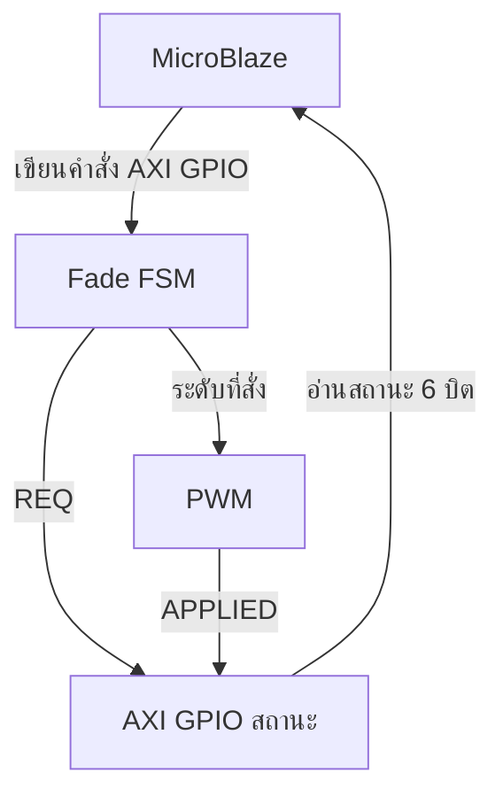

# LAB 09 — อ่านสถานะ PWM จาก Verilog ผ่าน AXI GPIO

ต่อจาก [LAB 08 — Verilog Fade FSM](https://chatgpt.com/library?file_id=libfile_d9e18cc34f6c8191ac6b47942364aa76&account_id=personal) เพิ่มทางอ่านสถานะจาก RTL กลับไปยัง MicroBlaze เมื่อส่ง `r` ทาง Serial Terminal จะเห็นทั้งระดับที่วงจรควบคุมส่งมา (**REQ**) และระดับที่วงจร PWM เก็บไว้ใช้จริง (**APPLIED**) เพื่อสังเกตว่าค่าใหม่ถูกนำไปใช้ที่ขอบคาบ PWM

**อุปกรณ์** Nexys A7-100T, สาย USB-JTAG, โปรเจกต์ LAB 08, Vivado และ Vitis Unified IDE รุ่นเดียวกัน ใช้ Classic MicroBlaze แบบ Standalone



| คำสั่ง UART | การทำงาน |
|---|---|
| `0`–`4` | ตั้ง duty cycle คงที่ 0%, 25%, 50%, 75% หรือ 100% |
| `s` หรือ `S` | ใช้ SW0 เลือก 25% หรือ 75% |
| `f` หรือ `F` | เริ่มไล่ความสว่างอัตโนมัติ |
| `r` หรือ `R` | อ่านค่า REQ และ APPLIED หนึ่งครั้ง |
| `?` | แสดงรายการคำสั่ง |

## 1. เปิดพอร์ตสถานะในวงจร PWM

แก้ไฟล์ `led_pwm.v` ในสำเนา LAB 08 ตามโค้ดด้านล่าง พอร์ต `applied_level` ส่งออกค่าจากรีจิสเตอร์ `active_level` ซึ่งรับค่าใหม่เมื่อจบช่วงที่ 3 ของคาบ PWM

```verilog
module led_pwm #(
    parameter [31:0] QUARTER_CYCLES = 32'd25_000
)(
    input  wire       clk,
    input  wire       resetn,
    input  wire [2:0] duty_level,
    output wire [2:0] applied_level,
    output reg        led
);
    reg [31:0] quarter_count;
    reg [1:0]  quarter_index;
    reg [2:0]  active_level;

    assign applied_level = active_level;

    always @(posedge clk) begin
        if (!resetn) begin
            quarter_count <= 32'd0;
            quarter_index <= 2'd0;
            active_level  <= 3'd0;
            led           <= 1'b0;
        end else begin
            led <= ({1'b0, quarter_index} < active_level);

            if (quarter_count == QUARTER_CYCLES - 32'd1) begin
                quarter_count <= 32'd0;
                quarter_index <= quarter_index + 2'd1;
                if (quarter_index == 2'd3) begin
                    active_level <= (duty_level > 3'd4) ? 3'd4 : duty_level;
                end
            end else begin
                quarter_count <= quarter_count + 32'd1;
            end
        end
    end
endmodule
```

## 2. ต่อวงจรอ่านสถานะใน Vivado

1. เปิด Block Design แล้ว refresh Module Reference ของ `led_pwm` ให้เห็นพอร์ต `applied_level` หากยังใช้ interface เดิม ให้เพิ่มโมดูลใหม่และต่อขา clock, reset, duty_level และ led ตาม LAB 08
2. เพิ่ม **AXI GPIO** ชื่อ `axi_gpio_status` ตั้งเป็น **Single Channel, All Inputs, GPIO Width = 6** แล้วใช้ **Run Connection Automation** เชื่อม `S_AXI` กับ AXI interconnect ใช้ clock 100 MHz และ peripheral reset ชุดเดียวกับ PWM
3. เพิ่ม **Concat (xlconcat)** ตั้งให้มี 2 อินพุต ขนาด 3 บิตต่ออินพุต แล้วต่อดังตาราง ทั้ง REQ และ APPLIED อยู่ในรีจิสเตอร์เดียว จึงอ่านได้ด้วย AXI read ครั้งเดียว การเปลี่ยนค่าสองชุดยังเกิดคนละจังหวะได้ระหว่างคาบ PWM

| ต้นทาง | ปลายทาง | บิตในรีจิสเตอร์สถานะ |
|---|---|---|
| `led_pwm/applied_level[2:0]` | Concat `In0` | `[2:0]` = APPLIED |
| `fade_controller/duty_level[2:0]` | Concat `In1` | `[5:3]` = REQ |
| Concat `dout[5:0]` | `axi_gpio_status/gpio_io_i[5:0]` | GPIO_DATA ที่ offset `0x00` |

4. กำหนด base address ของ GPIO สถานะใน **Address Editor** เช่น `0x40010000` หากช่วงนั้นถูกใช้แล้ว ให้ใช้ค่าที่ Vivado จัดสรรและแก้ `STATUS_GPIO_BASE` ในโค้ด ใช้ XDC ของ LAB 08 และตรวจว่าไม่มีการสร้างขาภายนอกเพิ่ม จากนั้น Validate Design, Generate Bitstream และ Export Hardware พร้อม Include bitstream

## 3. โปรแกรมใน Vitis

สร้างและ build platform จาก XSA ของ LAB 09 แล้วสร้าง **Empty Application** ให้ใช้โค้ดต่อไปนี้เป็น `src/main.c` ตรวจ base address ของ AXI GPIO เดิม, AXI GPIO สถานะ และ AXI UART Lite ให้ตรงกับ Address Editor

```c
#include "xil_io.h"

#define GPIO_BASE         0x40000000U
#define STATUS_GPIO_BASE  0x40010000U
#define UART_BASE         0x40600000U

#define SW_DATA           (GPIO_BASE + 0x00U)
#define PWM_SELECT        (GPIO_BASE + 0x08U)
#define PWM_STATUS        (STATUS_GPIO_BASE + 0x00U)
#define LEVEL_MASK        0x07U
#define REQUESTED_SHIFT   3U
#define SW0_MASK          0x01U

#define UART_RX           (UART_BASE + 0x00U)
#define UART_TX           (UART_BASE + 0x04U)
#define UART_STATUS       (UART_BASE + 0x08U)
#define UART_CONTROL      (UART_BASE + 0x0CU)
#define UART_RX_VALID     (1U << 0)
#define UART_TX_FULL      (1U << 3)
#define UART_RESET_FIFOS  0x03U

#define FADE_ENABLE  (1U << 3)
#define FADE_RESTART (1U << 4)

enum control_mode { MODE_SWITCH, MODE_MANUAL, MODE_FADE };

static enum control_mode mode = MODE_SWITCH;
static u32 manual_level;
static u32 restart_token;

static u32 selected_control(void)
{
    if (mode == MODE_FADE) {
        return FADE_ENABLE | restart_token;
    }

    u32 level = manual_level;
    if (mode == MODE_SWITCH) {
        level = (Xil_In32(SW_DATA) & SW0_MASK) == 0U ? 1U : 3U;
    }
    return restart_token | level;
}

static void uart_print(const char *message)
{
    while (*message != '\0') {
        while ((Xil_In32(UART_STATUS) & UART_TX_FULL) != 0U) {
        }
        Xil_Out32(UART_TX, (unsigned char)*message);
        ++message;
    }
}

static void report_pwm(void)
{
    static const char *const values[] = {"0%", "25%", "50%", "75%", "100%"};

    u32 status = Xil_In32(PWM_STATUS);
    u32 applied = status & LEVEL_MASK;
    u32 requested = (status >> REQUESTED_SHIFT) & LEVEL_MASK;

    uart_print("REQ=");
    uart_print(requested <= 4U ? values[requested] : "invalid");
    uart_print(" APPLIED=");
    uart_print(applied <= 4U ? values[applied] : "invalid");
    uart_print("\r\n");
}

static void handle_command(unsigned char command)
{
    static const char *const replies[] = {
        "OK 0%\r\n", "OK 25%\r\n", "OK 50%\r\n",
        "OK 75%\r\n", "OK 100%\r\n"
    };

    if (command >= '0' && command <= '4') {
        manual_level = (u32)(command - '0');
        mode = MODE_MANUAL;
        uart_print(replies[manual_level]);
    } else if (command == 's' || command == 'S') {
        mode = MODE_SWITCH;
        uart_print("OK SW0 mode\r\n");
    } else if (command == 'f' || command == 'F') {
        restart_token ^= FADE_RESTART;
        mode = MODE_FADE;
        uart_print("OK fade\r\n");
    } else if (command == 'r' || command == 'R') {
        report_pwm();
    } else if (command == '?') {
        uart_print("0: 0% | 1: 25% | 2: 50% | 3: 75% | 4: 100% | s: SW0 | f: fade | r: read PWM\r\n");
    } else if (command != '\r' && command != '\n') {
        uart_print("Unknown command. Send ?\r\n");
    }
}

int main(void)
{
    Xil_Out32(UART_CONTROL, UART_RESET_FIFOS);

    u32 applied_control = selected_control();
    Xil_Out32(PWM_SELECT, applied_control);
    uart_print("LAB 09 ready. Send ? for help.\r\n");

    for (;;) {
        if ((Xil_In32(UART_STATUS) & UART_RX_VALID) != 0U) {
            handle_command((unsigned char)Xil_In32(UART_RX));
        }

        u32 control = selected_control();
        if (control != applied_control) {
            Xil_Out32(PWM_SELECT, control);
            applied_control = control;
        }
    }
}
```

## 4. รันและตรวจผล

เปิด Serial Terminal ที่ **115200 baud, 8-N-1, flow control = None** แล้วรันผ่าน JTAG

| การทดสอบ | ผลที่คาดหวัง |
|---|---|
| ส่ง `2`, รอให้ LED0 คงที่ แล้วส่ง `r` | `REQ=50% APPLIED=50%` |
| ส่ง `0` แล้วส่ง `r` หลัง LED0 ดับ | `REQ=0% APPLIED=0%` |
| ส่ง `s`, ตั้ง SW0 = 1 แล้วส่ง `r` | `REQ=75% APPLIED=75%` |
| ส่ง `f` แล้วส่ง `r` หลายครั้งห่างกัน | ค่าที่อ่านเปลี่ยนตามขั้นของวงจรไล่ความสว่าง |

**สังเกตขอบคาบ PWM** หากมี ILA ให้จับ `duty_level` และ `applied_level` ด้วย clock 100 MHz ตั้ง trigger เมื่อ `duty_level` เปลี่ยน แล้วส่ง `1` หรือ `3` สลับกัน ค่าที่ REQ เปลี่ยนจะถูกนำไปใช้เมื่อถึงขอบคาบ PWM ถัดไป จึงอาจต่างกันชั่วคราวไม่เกินประมาณ 1 ms ใช้ capture depth 131,072 samples และวาง trigger ใกล้ต้น buffer เพื่อครอบคลุม 100,000 clocks ของคาบ PWM หนึ่งคาบ

**แบบฝึกหัด** เพิ่มข้อความ `PENDING` ในคำตอบ `r` เมื่อสองระดับไม่เท่ากัน จากนั้นอธิบายว่าเหตุใดการกด `r` ด้วยมือจึงมักอ่านได้สองค่าเท่ากัน แม้ ILA จะเห็นช่วงที่ค่าต่างกัน

## เอกสารอ้างอิง

- [AMD AXI GPIO PG144 — Register Space](https://docs.amd.com/r/en-US/pg144-axi-gpio/Register-Space)
- [AMD AXI GPIO PG144 — GPIO Data Register](https://docs.amd.com/r/en-US/pg144-axi-gpio/AXI-GPIO-Data-Register-GPIOx_DATA)
- [AMD Vivado UG994 — Referencing a Module](https://docs.amd.com/r/en-US/ug994-vivado-ip-subsystems/Referencing-a-Module)
